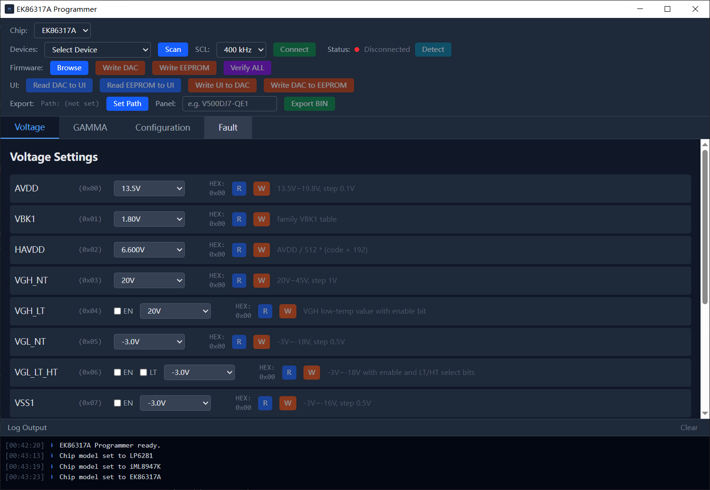

# EK86317A Programmer

这是一个为 EK86317A/LP6281/iML8947K 开发的桌面调试工具。通过 FTDI MPSSE / CH341A / CH347F 走 I2C 协议，实现对 PMU / VCOM 相关寄存器的读写、校验以及 EEPROM 烧录。

做这个工具的初衷是傻逼 Fitpower 在 2026 年用一个 8051 单片机和一个脑子抽了有病、没 log、逻辑还恶心人的上位机，关键这傻逼上位机还写 key 去算时长，是不是有病？

另外这是 Vibe Coding 产物。虽然让 Opus 4.6 写 plan，Sonnet / kimi 填代码，gpt-5.4-high 审核，强制要求写明代码注释，但不建议进行古法编译去修改代码。

## UI 预览



## 技术栈

- **前端**: React 18 + TypeScript + Vite
- **桌面**: Tauri 2
- **后端**: Rust
- **UI**: Tailwind CSS 4

## 目录结构

```text
.
├── src/                # 前端代码
│   ├── components/     # UI 组件
│   ├── hooks/          # 设备/寄存器状态逻辑
│   └── lib/            # 芯片模型、寄存器映射与 Tauri 命令封装
├── src-tauri/          # Rust 后端
│   ├── src/bridges/    # 桥接器抽象与 FTDI/CH34x/CH347/UART 实现
│   ├── src/pmu/        # PMU 芯片族、公用协议、命令入口
│   └── vendor/ch347/   # CH347 官方 Windows/Linux SDK 库
├── docs/               # 说明文档（UART 桥等）
├── package.json
└── vite.config.ts

```

## 开发环境

- Node.js: **24.x（本次验证使用 24.22.1；Vitest 5 / jsdom 31 不使用 Node 18）**
- Rust: Stable（本次验证使用 1.99.1）
- Windows: MSVC C++ Build Tools、Windows SDK、WebView2 Runtime；Linux 依赖见下文
- FTDI: `libftd2xx` optional `ftdi` feature，启用 `static`；识别白名单为 FT2232C/H、FT232H、FT4232H/HA
- CH347: `ch347f` feature，CH341A/CH347 共用；随附官方 Windows/Linux SDK 库

## 开始编译

安装依赖：

```bash
npm ci
```

硬件和界面调试：

```bash
npm run tauri dev
```

注：Debug 构建扫描时总会追加 `bridge:mock:development`，界面显示为 `Mock device bridge (development)`。它只验证 UI/IPC；Release 不提供 Mock。

## 编译打包

由于涉及原生驱动绑定 `libftd2xx` 和系统 WebView，不推荐在本地环境交叉编译。

编译命令：

```bash
npm run tauri build
```

如果在 Linux 环境下编译，需要先安装这些依赖：

```bash
sudo apt install libwebkit2gtk-4.1-dev libxdo-dev libssl-dev libayatana-appindicator3-dev librsvg2-dev
```

## 支持范围

| 路径 | 源码与构建资源 | 本次验证 |
| --- | --- | --- |
| Windows x64 | FTDI、CH341A/CH347、UART；NSIS/便携 EXE | MSVC 构建与软件测试；未做硬件验收 |
| Linux x64 / ARM64 | CH347 随附静态库；FTDI/UART 按目标依赖配置 | 源码支持，未在本机交叉构建或测试 |
| macOS / 其他架构 | CH347 后端及随附库未建立支持 | 不作为已支持目标 |
| `--no-default-features` | 排除 FTDI/CH347；UART 代码仍参与构建 | Rust 单元测试与 Clippy 通过 |

`ch347f` feature 同时覆盖 CH341A/CH347；CH347/CH341 的 `bus_recovery` 不发 FTDI 的 9 个 SCL 恢复脉冲。UI 的 100k/400k/1MHz 是配置选项，不代表已实测的电气速率。CH347 Windows 运行时需要随包的 `CH347DLLA64.dll`。

## UART 桥（不需要专用桥接器）

面板主芯片自己就有串口控制台，里面 §i2cget§ / §i2cset§ / §i2cdetect§ 都是现成的。
走这条路只要一根 USB-TTL，不用 FTDI/CH341A/CH347F 也能读写 PMU / VCOM。

- 切到 **UART Bridge** 页 → 选串口 → **Open / Test** → **Scan Bus**
- 需要跑完整 PMU 流程就点 **Connect as PMU**，之后 Toolbar 里所有按钮照常可用
- **交互终端**：连着敲、Tab 补全、粘贴自动分片，调完 PMU 直接 cp 换 bin；
  想裸读寄存器就直接敲 `i2cget -y -f 1 0x20 0x00`，不需要单独的调试面板

三个必须知道的坑（toybox 语法差异、7 位 vs 8 位地址、115200 不能传文件）见
[docs/UART-BRIDGE.md](docs/UART-BRIDGE.md)。

## 使用方法

- 选择芯片
- **Scan & Connect**: 点击 `Scan`，扫到 FTDI / CH341A / CH347F 后连接
- **Detect**: 确认 I2C 链路上 PMIC 芯片是否正常在线
- **Read DAC / Read EEPROM**: 将 DAC / EEPROM 数据同步到 UI
- 在 UI 上修改相对应参数
- **Export BIN**: 直接从 UI 当前参数导出，不需要连接烧录工具或芯片
- **Browse**: 导入 raw `.bin` 固件；HEX 不作为可加载输入
- **Write DAC**: 将已 Browse 的固件写入 DAC；**Write UI to DAC** 才是写入当前 UI 参数
- **Write DAC to EEPROM**: 将 DAC 数据写入 EEPROM；先保存原始 BIN，再验证参数与读回结果

## 避坑指南

- 短 BIN/稀疏固件保持可加载；未覆盖的地址不参与比较。`Verify ALL` 对缺失地址报告 `PARTIAL`，此时 `success=false`，不等同整片校验通过
- 空 DAC 快照表示未读取，不表示全零；GAMMA 及配置页未读时沿用原写入回退逻辑。写入前先读取目标页、确认参数，并保留原始固件；空/部分 UI 导出的 BIN 由芯片默认值补齐
- 交互终端与 I²C/PMU 操作互斥；UART 配置改变后需重新建立 PMU 会话
- 频繁烧写会损耗寿命，建议先备份并验证 DAC 参数，再写 EEPROM；固件支持 raw BIN，拒绝 HEX
- Release 构建不提供 Mock 设备，必须确保 FTDI / WCH 驱动环境正常
- CH341A 的 DLL 完全不回报从机 NACK：实测 `CH341StreamI2C`、`CH341ReadI2C`、`CH341WriteI2C` 在空载时一律返回 TRUE，连保留地址 0x7F 的读回都是总线上拉的 `0xFF`。所以检测不再看「调用返回了 OK」，而是先读保留地址 0x7F 取悬空基线，再读 PMIC 的 `0x00/0x0A/0x0B`：三个都等于基线判「无器件」，任一不等判「在位」。每次检测都会写日志到 `%LOCALAPPDATA%\EK86317A Programmer\ek86317a-programmer.log`（含基线与逐寄存器读数）；设 `EK86317A_CH341_TRUST_STREAM=1` 可恢复旧的「信任 stream 返回值」行为做对照
- `Export BIN` 的文件名格式为 `PMU_<芯片前缀>_<panel>_<时间戳>.bin`
- 本次 Windows x64 软件验证、交付文件及回滚见 [docs/REFACTOR.md](docs/REFACTOR.md)。物理桥接器、PMU、EEPROM、断电重读与目标板时序仍需单独实机验收

## 未来规划

- 继续补更多 IIC 调试工具。

## 重构交付

- [兼容重构、验证与回滚说明](docs/REFACTOR.md)
- [Windows x64 NSIS 安装包](desktop/build-artifacts/windows-x64/EK86317A%20Programmer_0.5.1_x64-setup.exe)
- [Windows x64 便携 ZIP](desktop/build-artifacts/windows-x64/EK86317A%20Programmer_0.5.1_windows-x64-portable.zip)
- [重构源码 ZIP](desktop/build-artifacts/windows-x64/EK86317A%20Programmer_0.5.1_refactored-source.zip)
- [SHA-256 清单](desktop/build-artifacts/windows-x64/SHA256SUMS.txt)与[构建记录](desktop/build-artifacts/windows-x64/BUILD_INFO.txt)

便携版解压后保留 EXE 与 `CH347DLLA64.dll` 在同一目录；校验命令：`Get-FileHash -Algorithm SHA256 <文件>`。在清单目录执行 `Get-Content SHA256SUMS.txt` 查看预期值。

## License

MIT License
